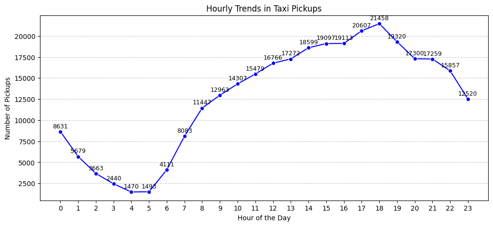
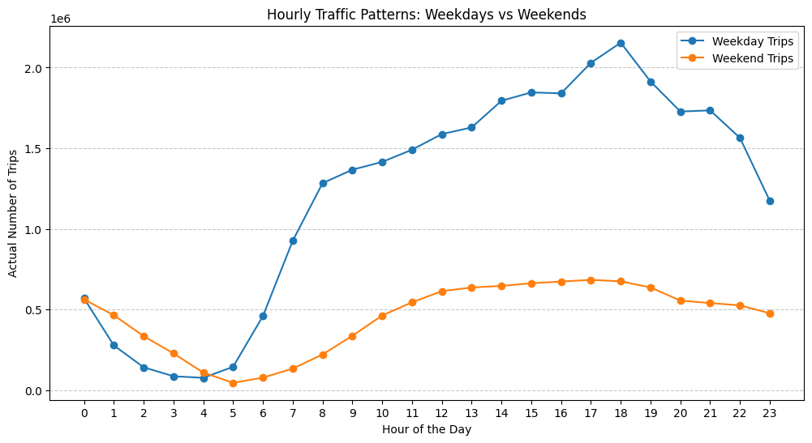
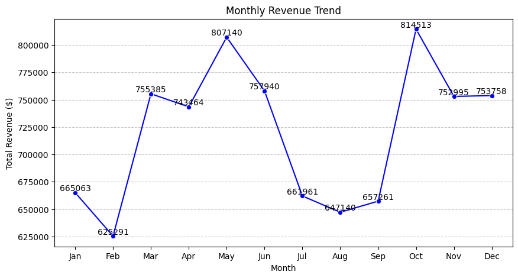
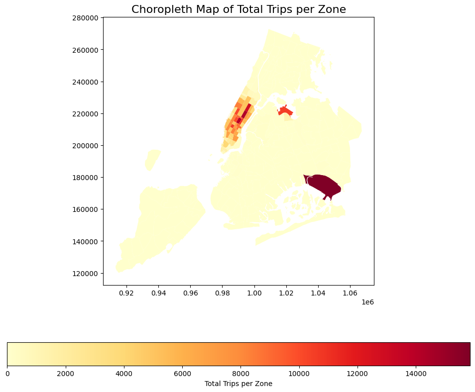

# NYC Yellow Taxi Trips, 2023: Exploratory Data Analysis

An end-to-end exploratory analysis of New York City yellow-taxi trips for 2023. It asks what the trip records say about **when and where demand is**, how **fares and tips** behave, and how a new operator could **position cabs and set prices**. The work covers stratified sampling of large Parquet files, data cleaning, geospatial joins and mapping, and a set of recommendations backed by the numbers.

The full analysis is in [`notebooks/nyc_taxi_eda.ipynb`](notebooks/nyc_taxi_eda.ipynb). Supporting write-ups:

- [`docs/methodology.md`](docs/methodology.md): how the data was sampled and cleaned, and why
- [`docs/findings.md`](docs/findings.md): results, recommendations, and the limitations of the analysis

## Highlights

All figures come from a 0.75% stratified sample (315,506 trips before cleaning; 300,792 in the final analysis set), so counts are sampled counts unless marked as estimates.

- **Demand peaks at 6 pm and bottoms out at 4–5 am.** Sampled pickups run from about 1,500 per hour in the small hours to about 21,500 at 6 pm.
- **Weekdays follow a commuting pattern, weekends a leisure one.** Weekday trips rise from 6 am and peak at 6 pm; weekends are flatter. From 1 am to 4 am, weekends are busier than weekdays.
- **Seasonality is clear.** May and October are the busiest months; July to September, and February, are the quietest. Q2 and Q4 together bring in about 54% of revenue.
- **Fare tracks distance, not passengers.** The fare-to-distance correlation is about 0.94; fare-to-passenger-count is about 0.04.
- **Credit cards dominate.** About 81% of trips are paid by card and about 17% by cash.
- **Night hours (11 pm to 5 am) bring in only about 12% of revenue.**
- **Demand is concentrated.** JFK Airport, the Upper East Side and Midtown top the pickup ranking.

## Charts









## Approach

| Stage | What happens |
| --- | --- |
| 1. Sample | Twelve monthly Parquet files (millions of trips each) are sampled at 0.75% for every pickup date and hour, so the time-of-day and seasonal structure is preserved. |
| 2. Clean | Merge duplicate columns, repair negative amounts, impute missing values, and remove impossible records. |
| 3. Explore | Temporal, financial and geographic analysis, then operations, pricing and customer experience, with a choropleth of trips per taxi zone. |
| 4. Recommend | Routing, cab-positioning and pricing suggestions drawn from the findings. |

## Repository layout

```
nyc-taxi-eda/
├── notebooks/
│   └── nyc_taxi_eda.ipynb      # the full analysis, run top to bottom
├── docs/
│   ├── methodology.md          # sampling and cleaning decisions
│   ├── findings.md             # results, recommendations, limitations
│   └── images/                 # charts used in this README
├── data/
│   └── README.md               # where to get the data and how to lay it out
├── requirements.txt
└── README.md
```

## Run it yourself

1. Create an environment and install the dependencies:

   ```bash
   python -m venv .venv
   source .venv/bin/activate          # Windows: .venv\Scripts\activate
   pip install -r requirements.txt
   ```

2. Download the 2023 trip files and the taxi-zone shapefile, and place them as described in [`data/README.md`](data/README.md). The data is public but is not stored in this repository.
3. Open `notebooks/nyc_taxi_eda.ipynb` in Jupyter and choose *Restart & Run All*. The first run draws the sample, which takes a while; later runs reuse the saved sample.

## Scope and limitations

The analysis is descriptive, and these limits matter when reading the results (details in [`docs/findings.md`](docs/findings.md)):

- **Trip durations are not cleaned.** A band of trips lasting about 24 hours remains in the data. It weakens the fare-versus-duration correlation, so the route-speed analysis demonstrates a method rather than producing a reliable result.
- **Weekday and weekend totals are not per day.** Weekdays cover five days against two, so weekday totals are higher partly for that reason.
- **Fare per mile and tip percentage are averages of per-trip ratios,** which very short trips inflate.
- **Zone-level results for low-volume zones are noisy** because they rest on a handful of sampled trips.
- **One year of data** cannot separate seasonality from a trend, and there is no predictive model.

## About this project

This started as a case study in a data-science course. The course brief and marking scheme are not part of this repository; the analysis code and write-up here are mine.

Built with Python, pandas, NumPy, matplotlib, seaborn, GeoPandas and PyArrow. Trip data and taxi-zone boundaries are from the NYC Taxi & Limousine Commission.
