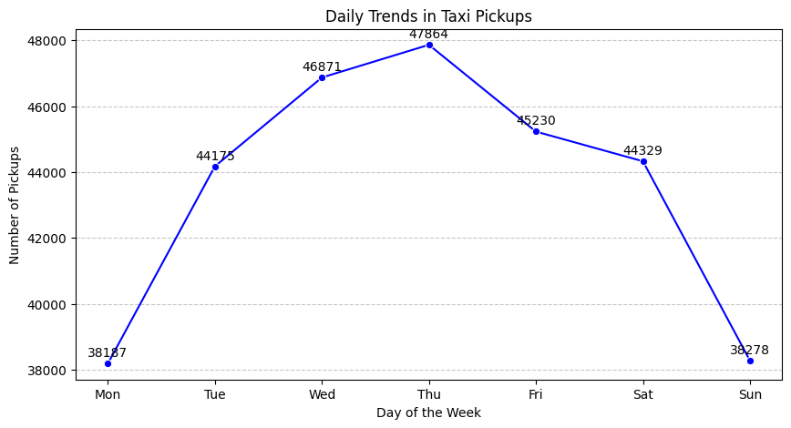

# Findings and recommendations

Results from the 2023 yellow-taxi analysis. Everything is based on a 0.75% stratified sample (see [methodology](methodology.md)), so counts are sampled counts unless marked as estimates, and zone-level numbers rest on small samples.

## Demand over time

- **Hour of day.** Sampled pickups fall to about 1,500 per hour at 4–5 am and peak at about 21,500 at 6 pm. Scaled up, the five busiest hours are 6 pm (about 2.83 million trips a year), 5 pm (2.71 million), 7 pm (2.55 million), 4 pm (2.51 million) and 3 pm (2.51 million).
- **Day of week.** Thursday is the busiest day (47,864 sampled pickups); Monday (38,187) and Sunday (38,278) are the quietest, with Saturday at 44,329.
- **Month.** May (28,088) and October (27,773) are the busiest; July (23,185), August (22,634) and September (22,292) are the quietest, with February (23,350) also low.
- **Revenue.** Follows the same seasonal shape. October has the highest monthly revenue and February the lowest. By quarter: Q4 26.9%, Q2 26.7%, Q1 23.7%, Q3 22.8%.

## Weekdays versus weekends

- **Weekdays:** trips climb from about 6 am, reach a shoulder at 8–9 am, keep rising through the afternoon and peak at 6 pm, then fall towards midnight. That is a commuting pattern.
- **Weekends:** the profile is much flatter, with a gentle peak around 5 pm, pointing to leisure travel.
- **Late night:** from 1 am to 4 am weekends are busier than weekdays, even though they cover only two days of the week.
- Weekday totals are higher partly because there are five weekdays to two weekend days; the comparison is not per day.

## Geography

- **Busiest pickup zones:** JFK Airport, Upper East Side South, Midtown Center, Upper East Side North and Midtown East, in that order.
- **Pickup-to-drop-off ratio.** Zone 70 is highest at about 7.3 (1,359 pickups against 186 drop-offs), followed by zone 132, JFK Airport (4.9), and zone 138 (2.9). A high ratio means cabs pick up in these zones but rarely end trips there, so supply drains and has to be brought in.
- **Overnight pickups (11 pm to 5 am).** Zones 79 (2,529 sampled trips), 132 (2,325) and 249 (2,033) lead.

## Fares, tips and payment

- **Fare tracks distance.** The fare-to-distance correlation is about 0.94 and the total-to-distance correlation about 0.94; the fare-to-passenger-count correlation is only about 0.04. Tips rise with distance more loosely (about 0.59).
- **Short trips earn the most per mile.** Average fare per mile for 0–2 mile trips is about $10 for vendor 1 and $21 for vendor 2, falling to about $6.4 and $6.6 for 2–5 miles and about $4.4 and $4.5 beyond 5 miles. The vendors differ sharply only on short trips.
- **Fare per mile by weekday** ranges from about $11.2 (Tuesday) to $15.2 (Sunday); Friday and Saturday are about $13.1–13.4.
- **Tips.** Average tip is about 22% of the fare for 0–2 mile trips, 19% for 2–5 miles and 20% beyond 5 miles. By passenger count it sits at 17–21% for every group except five passengers (about 72%), an outlier.
- **Payment.** About 81% of trips are paid by credit card and about 17% by cash.
- **Night revenue.** The seven night hours bring in about 12% of revenue (11.9% night, 88.1% day).

## Passengers

Groups are largest late at night and at weekends: about 1.45–1.46 passengers per trip from 1 am to 3 am, and 1.46–1.48 on Saturday and Sunday against 1.33–1.36 from Monday to Thursday. The zones with the highest average group size (Arrochar/Fort Wadsworth, Murray Hill-Queens, Mount Hope, Springfield Gardens South, Newark Airport) are mostly outer-borough zones that probably see few trips, so their averages are noisy.

## Surcharges

Across trips, the MTA tax applies to about 99.4%, the congestion surcharge to about 92.9%, the "extra" charge to about 62.0%, and tolls to about 8.0%.

## Recommendations

**Routing and dispatching**

- Keep more cabs available in the highest-volume zones (JFK Airport, the Upper East Side, Midtown) and raise dispatch frequency around the weekday evening peak (the five busiest hours are 3 pm to 7 pm).
- Route empty cabs into pickup-heavy zones such as zone 70, where pickups far outnumber drop-offs.
- Reduce supply from about 3 am to 5 am, when pickups are at their lowest, and in weak zones from July to September.

**Positioning**

- Position cabs near the airports and the busiest zones ahead of the evening peak, and maximise availability at 6 pm.
- Move cabs away from zones with no demand (for example Jamaica Bay, which recorded no pickups in the sample) towards busier zones or the airports.
- Shorter trips earn more per mile, so keep cabs at common drop-off points too, such as zones 236 and 237 on the Upper East Side.

**Pricing**

- Introduce surge or peak pricing for the weekday evening peak and for airport trips, and higher minimum fares at airports while keeping per-mile rates competitive.
- Offer pre-booking discounts to lock in demand ahead of peaks, and priority booking at a premium.
- Night hours are only about 12% of revenue, so a flat-rate night fare or a night pass could stimulate demand at little risk.
- Lower base fares in persistently low-demand zones to encourage demand.

## Limitations

1. **Trip durations are not cleaned.** The fare-versus-duration scatter shows a band of trips lasting about 1,400 minutes (roughly 24 hours) and a few even longer, almost certainly recording errors. They weaken the fare-to-duration correlation (about 0.26) and dominate the slowest-route analysis, which is therefore a demonstration of the method rather than a reliable result.
2. **The weekday and weekend comparison is not per day.** Weekdays cover five days against two, so weekday totals are higher partly for that reason.
3. **Fare per mile and tip percentage are means of per-trip ratios,** which very short trips inflate.
4. **Zone-level results are noisy** because many zones have only a few sampled trips. The surcharge-by-zone analysis applies a minimum-trip threshold for this reason.
5. **Imputation had little effect.** The records with missing fields appear to be the same ones later removed as payment type 0 (see methodology).
6. **Negative amounts were treated as sign errors,** which is an assumption; if they are refunds, dropping them would be more appropriate.
7. **Tips describe card payers only,** because cash tips are not recorded.
8. **One year of data and no model.** Seasonality cannot be separated from a trend, and the analysis is descriptive.
